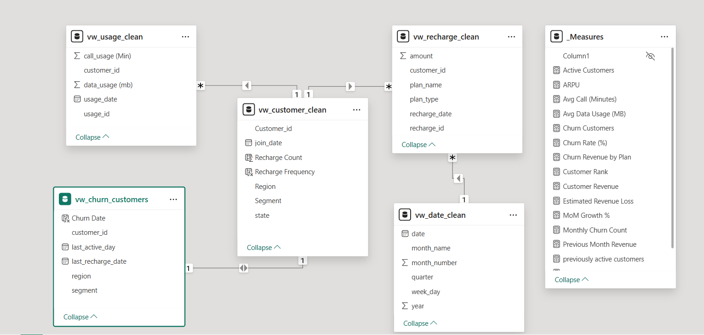
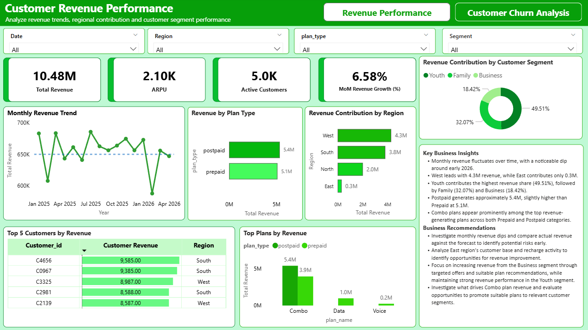
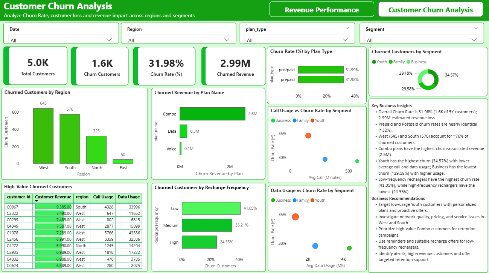

# Telecom Revenue and Customer Churn Analysis

## Project Overview
Developed an end-to-end Telecom Revenue and Customer Churn Analysis solution using SQL Server and Power BI to evaluate revenue performance, analyze customer churn patterns, and identify customer segments requiring retention attention.
The project involves cleaning and validating telecom data, building structured SQL views, defining business-focused KPIs, and developing interactive Power BI dashboards. The analysis explores revenue trends, Average Revenue Per User (ARPU), customer activity, recharge behavior, and churn patterns to generate actionable business insights and support data-driven decision-making.

---
## Business Problem

Telecom businesses need to monitor revenue performance and customer churn to maintain customer relationships and support sustainable revenue growth. However, analyzing revenue trends, customer activity, and recharge behavior across multiple datasets can make it difficult to identify customer segments that may require retention attention.
This project addresses these challenges by analyzing telecom revenue, Average Revenue Per User (ARPU), customer usage patterns, recharge behavior, and churn indicators. The analysis aims to identify revenue trends, understand churn patterns across customer segments, and highlight revenue associated with churned customers to support informed business decisions.

---
## Project Objectives

- Analyze telecom revenue trends to understand revenue performance across months, regions, plans, and customer segments.
- Evaluate key performance indicators (KPIs), including Total Revenue, Average Revenue Per User (ARPU), and Churn Rate, MoM Growth.
- Identify customer churn patterns using customer usage and recharge inactivity indicators.
- Compare churn patterns across customer segments, subscription plans, regions, and recharge frequency.
- Highlight customer segments requiring retention attention and assess revenue associated with churned customers.
- Develop interactive Power BI dashboards to present actionable insights and support data-driven business decisions.
  
---
## Tools & Technologies

- **SQL & Database:** SQL Server, SQL Server Management Studio (SSMS), SQL Queries, Joins, CTEs, Data Cleaning, Data Transformation, Data Validation, Views
- **Data Visualization:** Microsoft Power BI, Power BI Desktop, Interactive Dashboards, KPI Reporting, Data Visualization
- **Data Modeling:** Star Schema, Fact and Dimension Tables, Table Relationships
- **DAX & Analytics:** DAX Measures, Calculated Columns, CALCULATE, FILTER, DISTINCTCOUNT, IF, KPI Calculations, ARPU, Revenue Growth, Churn Rate
  
---
## Data Preparation & Modeling

### SQL Data Preparation
- Cleaned and validated telecom datasets using SQL Server to improve data consistency and reliability.
- Handled missing values, standardized inconsistent text values, and validated data types using appropriate SQL functions.
- Created reusable SQL Views to organize cleaned customer, recharge, usage, and date data.
- Developed churn identification logic using customer usage and recharge inactivity criteria to identify customers requiring retention attention.
- Used SQL joins, CTEs, aggregations, and validation queries to support the analysis.

 

### Power BI Data Modeling
- Built a structured data model connecting customer, recharge, usage, and date tables.
- Established relationships between relevant tables using Customer ID and date fields.
- Organized the data model to support revenue analysis, customer activity monitoring, and churn analysis.
- Prepared the model for interactive reporting and DAX-based KPI calculations.

## DAX Calculated Columns & Measures

Developed DAX calculated columns and measures in Power BI to analyze customer recharge behavior, identify churn patterns, and monitor telecom revenue performance.

### Calculated Columns

- **Recharge Count:** Calculated customer recharge counts to analyze recharge activity.
- **Recharge Frequency:** Classified customers based on their recharge frequency to compare customer behavior and churn patterns.
- **Churn Date:** Created a date field to support churn-related analysis and date-based reporting.

### DAX Measures
Developed measures to calculate key performance indicators, including:
- **Total Revenue:** Measures overall revenue generated from recharge transactions.
- **Average Revenue Per User (ARPU):** Evaluates average revenue per customer.
- **Active Customers:** Counts customers meeting the defined activity criteria.
- **Revenue Growth %:** Tracks changes in revenue across reporting periods.
- **Churn Rate %:** Measures the proportion of churned customers relative to the defined customer base.
- **Churned Revenue:** Evaluates revenue linked to customers identified as churned.

These calculations support interactive KPI reporting, customer segmentation, revenue performance analysis, and data-driven retention decisions.

**DAX Documentation:**

## Dashboard Pages

### Page 1: Revenue Performance
Analyzes telecom revenue performance through interactive KPIs and visualizations.

- Monitors Total Revenue, ARPU, Active Customers, and Revenue Growth.
- Analyzes monthly revenue trends to understand revenue performance over time.
- Compares revenue across regions, plans, and customer segments.
- Highlights top revenue-generating customers and plans to support business analysis.

### Page 2: Customer Churn Analysis
Examines customer churn patterns and recharge behavior to identify segments requiring retention attention.

- Tracks total customers, churned customers, churn rate and revenue associated with churned customers.
- Compares churn patterns across regions, by plans, and customer segments.
- Analyzes churn patterns by recharge frequency to understand differences in customer behavior.
- Examines revenue associated with churned customers to assess their revenue contribution.
- Uses interactive filters to explore customer segments and identify areas for further investigation.

## Power BI Dashboard & Project File

Explore the complete interactive Power BI dashboard by downloading the project file

## Key Business Insights

### Revenue Performance
- Monthly revenue fluctuates over time, with a noticeable dip around early 2026.
- The West region contributes the highest revenue at approximately 4.3M, while the East region contributes approximately 0.3M.
- The Youth segment contributes the largest share of revenue (49.51%), followed by Family (32.07%) and Business (18.42%).
- Postpaid generates approximately 5.4M in revenue, slightly higher than Prepaid at 5.1M.
- Combo plans feature prominently among the top revenue-generating plans across Prepaid and Postpaid categories.

### Customer Churn Analysis
- The overall churn rate is 31.98%, representing approximately 1.6K churned customers out of 5K customers.
- Prepaid and Postpaid have nearly identical churn rates of approximately 32%.
- The West region (645 churned customers) and South region (576 churned customers) together account for approximately 76% of churned customers.
- Churned customers account for approximately 2.99M in associated revenue, highlighting the revenue contribution of customers identified as churned.
- The Youth segment has the highest churn rate (34.57%), while the Business segment has the lowest (29.18%).
- Low-frequency rechargers have the highest churn rate (41.05%), whereas high-frequency rechargers have the lowest (24.55%).
  
## Business Recommendations

### Revenue Performance
- Investigate monthly revenue fluctuations to identify periods of decline and opportunities to improve revenue consistency.
- Analyze customer base size and recharge activity in the East region to identify potential revenue improvement opportunities.
- Explore targeted offers and suitable plan recommendations for the Business segment while maintaining revenue performance in the Youth segment.
- Analyze the performance of Combo plans across customer segments and subscription types to identify opportunities for relevant plan promotions.

### Customer Churn Analysis
- Identify Youth customers with low usage and evaluate personalized plans or relevant offers to support retention.
- Investigate possible service quality, pricing, and customer experience issues in the West and South regions, where churned customer counts are high.
- Prioritize high-value customers among the churned customer base for further analysis and use the findings to design targeted retention strategies.
- Use recharge reminders and suitable recharge offers to encourage consistent recharge activity among low-frequency rechargers.
- Analyze the approximately 2.99M revenue associated with churned customers to understand the financial significance of churn and guide future retention planning.

## Project Outcomes

This project demonstrates an end-to-end telecom data analysis workflow using SQL Server and Power BI. It combines data cleaning, SQL views, data modeling, DAX calculations, and interactive dashboards to analyze revenue performance, customer activity, recharge behavior, and churn patterns.
The analysis highlights key revenue-generating segments, identifies customer groups with higher churn rates, and quantifies the revenue associated with customers identified as churned. These insights can help businesses prioritize retention analysis, evaluate customer engagement, and make data-driven decisions.
Through this project, I strengthened my practical skills in SQL, Power BI, data modeling, DAX, KPI reporting, and business insight generation.

---
